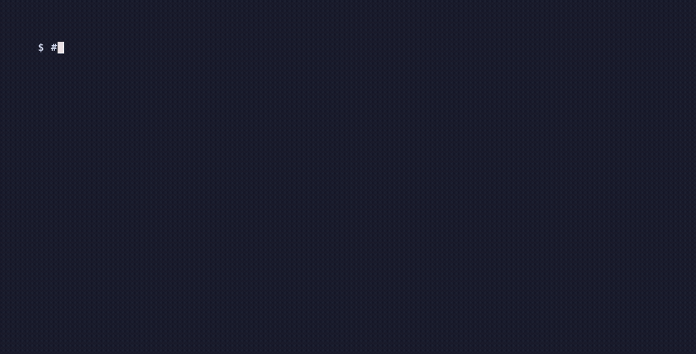

# shotlog-mcp

**Que tu asistente de IA tome las capturas de tu informe.**

Es un servidor [MCP](https://modelcontextprotocol.io) para macOS. Captura una ventana concreta, la guarda con un número consecutivo y una ficha (actividad, comando, resultado), y junta todo en un informe Markdown que puedes convertir a PDF.

Nació en un laboratorio de Sistemas Operativos donde cada paso tenía que respaldarse con una captura, trabajando a la vez en un Mac y en un portátil Windows. También sirve para evidencias de QA, tutoriales, runbooks y reportes de bugs.

[Read in English](README.md)



## Herramientas

| Herramienta | Qué hace |
|---|---|
| `list_windows` | Lista las ventanas visibles. |
| `save_screenshot` | Captura **una** ventana, elegida por app o título (si no indicas nada, la que está al frente), y la guarda como `001_nombre.png` con su ficha. |
| `update_caption` | Completa o corrige la ficha después. |
| `list_screenshots` | Muestra el registro en orden. |
| `pull_remote_screenshots` | Trae por SCP las capturas nuevas de otro equipo (por ejemplo `Imágenes\Capturas` en Windows) y las numera en la misma serie. |
| `export_report` | Genera `report.md` con todas las capturas y sus fichas, en orden. |

Luego solo pides: *"Ejecuta `ssh -V` en la terminal, toma una captura y ponle como ficha el paso 3."*

## Instalación

Necesitas macOS, Python 3.11+ y [uv](https://docs.astral.sh/uv/).

```bash
claude mcp add shotlog -- uvx shotlog-mcp
```

Para la primera captura hay que dar el permiso de **Grabación de pantalla** a la app que ejecuta el servidor: *Ajustes del Sistema → Privacidad y seguridad → Grabación de pantalla*.

La carpeta de destino se cambia con `SHOTLOG_DIR` (por defecto es `~/shotlog`).

Para pasar el informe a PDF: `pandoc report.md -o report.pdf`

## Licencia

MIT
