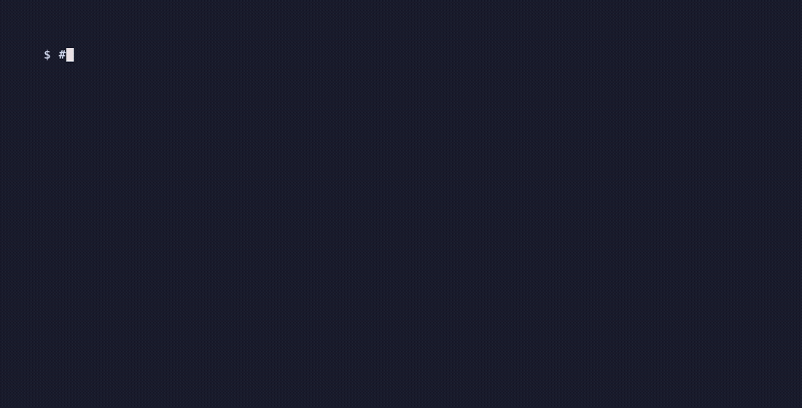

# shotlog-mcp

**Let your AI assistant take the screenshots for your report.**

An [MCP](https://modelcontextprotocol.io) server for macOS. It captures a specific window, saves it with a sequential number and a caption (activity, command, result), and puts everything together into a Markdown report you can turn into a PDF.

It was built for a university OS lab where every step had to be backed by a screenshot, on a Mac and a Windows laptop at the same time. It works the same way for QA evidence, tutorials, runbooks and bug reports.

[Leer en español](README.es.md)



<!-- mcp-name: io.github.Marlon-Trujillo-Jaramillo/shotlog-mcp -->

## What it does

| Tool | Description |
|---|---|
| `list_windows` | Lists the visible windows (app, title, size). |
| `save_screenshot` | Captures **one** window, picked by app and/or title (front-most by default), and saves it as `001_name.png` together with its caption. |
| `update_caption` | Fills in or fixes the caption afterwards. |
| `list_screenshots` | Shows the log in order. |
| `pull_remote_screenshots` | Fetches new screenshots from another machine (e.g. Windows' `Pictures\Screenshots`) over SCP and numbers them in the same sequence. |
| `export_report` | Writes `report.md`: every screenshot with its caption, in order. |

Then just ask: *"Run `ssh -V` in the terminal, take a screenshot of it and caption it as step 3."*

## Install

Requires macOS, Python 3.11+ and [uv](https://docs.astral.sh/uv/).

**Claude Code**

```bash
claude mcp add shotlog -- uvx shotlog-mcp
```

**Claude Desktop / other MCP clients**

```json
{
  "mcpServers": {
    "shotlog": { "command": "uvx", "args": ["shotlog-mcp"] }
  }
}
```

The first capture needs the **Screen Recording** permission for the app that runs the server (Terminal, iTerm, VS Code, Claude…): *System Settings → Privacy & Security → Screen Recording*.

## Configuration

| Variable | Default | |
|---|---|---|
| `SHOTLOG_DIR` | `~/shotlog` | Where screenshots, `manifest.json` and `report.md` are saved. |

Use one folder per project: `claude mcp add shotlog -e SHOTLOG_DIR=~/lab3/shots -- uvx shotlog-mcp`

### Remote screenshots (optional)

To use `pull_remote_screenshots`, the other machine needs an SSH server (on Windows: *Settings → Optional features → OpenSSH Server*) and key-based login from your Mac, so that no password is asked for.

## Report to PDF

```bash
cd ~/shotlog && pandoc report.md -o report.pdf
```

## Development

```bash
uv run --group dev pytest
```

## License

MIT
